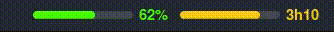

# Logtime Widget - GNOME Shell Extension

A GNOME Shell extension that tracks and displays your monthly logtime for 42 School. Shows real-time progress towards your monthly hour requirements with visual status indicators.

## Screenshots



## Installation

### Automated Installation

```
git clone https://github.com/SaruM4N3/LogtimeWidget.git
cd LogtimeWidget
git switch 42LyonFix
./install.sh
```

### Manual Installation

Copy extension files
```
git clone https://github.com/SaruM4N3/LogtimeWidget.git
cd LogtimeWidget
mkdir -p ~/.local/share/gnome-shell/extensions/soft-brightness@fifi.org
cp -r connect data utils extension.js metadata.json prefs.js stylesheet.css \
    ~/.local/share/gnome-shell/extensions/soft-brightness@fifi.org/
```

Enable the extension
```
gnome-extensions enable soft-brightness@fifi.org
```

Restart GNOME Shell
```
X11:    Alt+F2 → type 'r' → Enter
Wayland: log out and log back in
```

## First Time Setup

The widget reads your presences from **[attendance.42lyon.fr](https://attendance.42lyon.fr/me)** — no API keys needed.

1. When the widget starts, a **login window** opens on the 42 Intra login page
2. Log in with your 42 account — the window closes by itself once you're connected
3. The widget starts displaying your logtime

Your Intra login is remembered, so when the attendance session expires the window reconnects you automatically
(it only asks for your password again if the Intra session expired too).

To switch account: **Settings → Account → Log out / Switch account**.

## Usage

### Menu Options

- **Refresh / Reconnect** — Force an immediate data refresh (opens the login window if you're logged out)
- **Open Attendance** — Open attendance.42lyon.fr in your default browser
- **Restart Widget** — Restart the extension
- **Settings** — Open extension preferences

### Display Formats

Choose your preferred format in Settings:

| Format | Example |
|--------|---------|
| **Current / Needed** | `50h47/84h` |
| **Remaining Hours** | `Remaining: 33h12` |
| **Combined** | `50h47/84h \| Remaining: 33h12` |

You can also toggle **Show Minutes** to hide the minutes and keep the display compact.

**Display Mode** chooses what the panel shows: **Text**, **Progress Bar** (bars only) or **Combined** (text + bars).
The bars are picked by the display format:

| Format | Bar |
|--------|-----|
| **Current / Needed** | Month progress, with the attendance percentage next to it |
| **Remaining Hours** | Time before your next badge: the session expires 4h after the last clock-in and unsaved time is lost |
| **Combined** | Both |

During the last 15 minutes before the session expires, the badge bar blinks in the alert color (red by default) with a `Badge! m:ss` countdown.

**Panel Position** puts the widget on the left, center or right of the top bar (applied immediately).

**Colors** follow the display mode: **Text Colors** (start / end / ahead gradient and its curve) color the text, **Progress Bar Colors** set the main bar, the badge bar and the badge alert.

### Configuration

Preferences and the attendance session are stored locally in:
```
~/.local/share/gnome-shell/extensions/soft-brightness@fifi.org/utils/saved_days.json
~/.local/share/gnome-shell/extensions/soft-brightness@fifi.org/utils/session.json
```
The login window's browser data (Intra login) is kept in `~/.local/share/LogtimeWidget/webkit/`.

Logs are written to `~/.local/share/LogtimeWidget/logtime.log` (also in the GNOME Shell journal). Open them from **Settings → Storage Information → Open Logs**.

## Features

- **Same Logtime as Attendance** — Done/required hours are computed exactly like attendance.42lyon.fr: calendar workdays, absences, internships, closures, workday reduction and activated capsules. Refreshed every 60 seconds
- **Visual Status Indicators**
  - Red → below target
  - Green → on track
  - Cyan → above target
- **Active Session Aware** — A session in progress counts up to its last badge ping, like on attendance
- **42 Intra Login** — Log in once through the official 42 login page, no API keys
- **Auto Reconnect** — Expired sessions are renewed automatically
- **Manual Refresh** — Force refresh anytime from the dropdown menu

## Requirements

- GNOME Shell 42 or later
- A 42 Lyon account (attendance.42lyon.fr)
- WebKit2GTK 4.0 GObject bindings for the login window (`gir1.2-webkit2-4.0`, preinstalled on Ubuntu 22.04)

## File Structure

```
./
├── connect/
│   ├── connect.js          # Opens the login window
│   ├── login.js            # Login window (WebKit), saves the attendance cookie
│   └── updater.js
├── data/
│   ├── data.js             # attendance.42lyon.fr requests & periodic refresh
│   └── storage.js          # Local settings persistence
├── utils/
│   ├── calculation.js      # Logtime stats (port of attendance's calculation)
│   ├── debug.js
│   └── settings.js
├── extension.js            # Main extension entry point
├── metadata.json
├── prefs.js                # Settings UI
├── stylesheet.css
├── install.sh
├── uninstall.sh
└── README.md
```

## Debugging

View extension logs in real time:
```
journalctl -f -o cat /usr/bin/gnome-shell
```

Or use Looking Glass: `Alt+F2` → type `lg`

## Troubleshooting

### Widget shows "Not logged in: click to reconnect"

- The login window was closed before logging in — click the widget → **Refresh / Reconnect**
- If the login page shows an access error, your account isn't allowed on attendance.42lyon.fr (42 Lyon staff & students only)

### Login window is blank

- Check that WebKit2GTK is installed: `sudo apt install gir1.2-webkit2-4.0`

### Extension doesn't appear after installation

```
gnome-extensions list --enabled | grep LogtimeWidget
gnome-extensions enable soft-brightness@fifi.org
```

Then restart GNOME Shell.

## Uninstallation

```
chmod +x uninstall.sh
./uninstall.sh
```

Or manually:
```
gnome-extensions disable soft-brightness@fifi.org
rm -rf ~/.local/share/gnome-shell/extensions/soft-brightness@fifi.org
```

## Privacy & Security

- Your session cookie is stored **locally only** in `session.json` — your password is never stored by the widget
- Login goes through the official 42 Intra login page
- No data is sent anywhere except `attendance.42lyon.fr` and `intra.42.fr`

## License

There's no License, come on.

## Credits

- Developed by zsonie
- Built with GNOME Shell Extension APIs and attendance.42lyon.fr

## Support

For issues, questions, or feature requests, please open an issue on the project repository.

---

**Note**: This extension is not officially affiliated with or endorsed by any 42 School.
